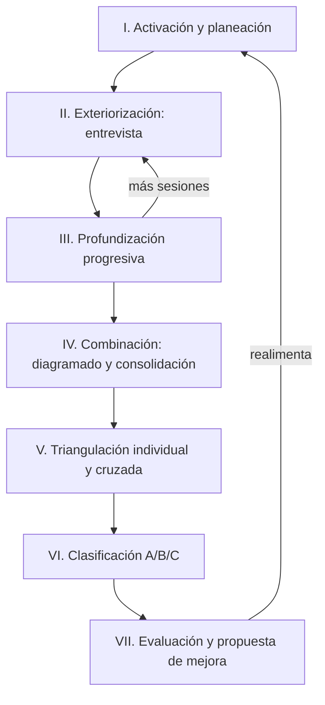

# Mapa Vivo

## Manual Metodológico Integral

### Sistema institucional de mapeo de procesos, resguardo del conocimiento operativo y mejora continua

---

**Centro de Investigación en Innovación y Tecnología Educativa (CIITE)**
Universidad Marista de Querétaro

**Versión 3.0 — Edición consolidada**
Querétaro, México · 2026

*Fundamento teórico: Nonaka, I. & Takeuchi, H. (1995). The Knowledge-Creating Company. Oxford University Press.*

---

> **Naturaleza de este documento.** Este manual unifica en un solo texto la totalidad de la documentación del Mapa Vivo: su fundamento conceptual, su arquitectura de sistema, su secuencia operativa y sus instrumentos. Está escrito para ser aplicado por equipos reales. No es una presentación institucional ni un documento de sensibilización: es la referencia operativa completa del método. La conducción de la metodología recae en un único rol metodológico —el **Investigador del Conocimiento**—, que dialoga con dos tipos de portadores del saber: el **Ingeniero del Conocimiento** (el líder del área, que aporta la visión global y habilita el acceso) y los **Actores del área** (el personal que opera los procesos cotidianos y posee el conocimiento tácito del quehacer diario).

---

## Tabla de contenido

**Parte I — Marco general**
1. Introducción general
2. Propósito del Mapa Vivo
3. Lo perecedero frente a lo que perdura

**Parte II — Fundamentos conceptuales**
4. Conocimiento tácito y conocimiento explícito
5. El modelo SECI
6. El concepto de *Ba*
7. La espiral del conocimiento
8. Analogía y metáfora como instrumentos cognitivos

**Parte III — Arquitectura sistémica**
9. Visión de sistema
10. Los actores del método
11. El Investigador del Conocimiento como único rol metodológico
12. Principios rectores

**Parte IV — Secuencia operativa**
13. Panorama del ciclo
14. Fase I — Activación y planeación de la ruta
15. Fase II — Exteriorización: la entrevista
16. Fase III — Profundización progresiva
17. Fase IV — Combinación: diagramado y consolidación individual
18. Fase V — Triangulación
19. Fase VI — Clasificación del conocimiento (A / B / C)
20. Fase VII — Evaluación institucional y propuesta de mejora
21. El ciclo continuo

**Parte V — Instrumentos**
22. Catálogo de instrumentos del sistema

**Parte VI — Operación**
23. Procedimiento operativo paso a paso (lista maestra)
24. Ejemplos explicativos

**Parte VII — Gobernanza**
25. Gobernanza, confidencialidad y ética

**Parte VIII — Cierre**
26. Conclusiones y recomendaciones de uso
27. Glosario
28. Referencias

---

# Parte I — Marco general

## 1. Introducción general

El **Mapa Vivo** es el dispositivo institucional con el que la Universidad Marista de Querétaro convierte el saber operativo de sus áreas en patrimonio de la organización. La mayor parte del conocimiento que sostiene la operación cotidiana de una institución no está escrita en ningún manual: vive en las personas, en sus manos, en sus contactos y en el criterio que construyeron con los años. Cuando esa persona no está —por rotación, ausencia o cambio de adscripción—, no se va únicamente una función: se va un método aprendido en años.

El Mapa Vivo existe para hacer visible ese conocimiento, estructurarlo, protegerlo y, donde sea pertinente, liberar tiempo humano de lo repetitivo mediante automatización o asistencia digital. Su premisa central distingue dos temporalidades:

- **Las herramientas envejecen.** Las plataformas, suites y aplicaciones se vuelven obsoletas con velocidad creciente.
- **El conocimiento perdura.** Los procesos, las nomenclaturas, las validaciones y los criterios sobreviven al cambio tecnológico, si se los articula con método.

De esa distinción se sigue el principio que define la oferta del CIITE: **no se entrega software, se construye conocimiento.** Lo que el método produce —métodos, esquemas y criterios investigados— es un saber transferible que no caduca con la próxima versión de la herramienta.

Este manual describe el método completo: por qué funciona (fundamento teórico), cómo está organizado (arquitectura), cómo se ejecuta (secuencia operativa) y con qué se opera (instrumentos).

## 2. Propósito del Mapa Vivo

El propósito del Mapa Vivo puede enunciarse en una sola frase: **transformar el saber distribuido en personas y rutinas en patrimonio organizacional documentado, replicable y en mejora continua**, sin imponer procesos invasivos a quien posee ese saber.

De este propósito general se derivan cuatro objetivos operativos:

| # | Objetivo | Qué significa en la práctica |
|---|----------|------------------------------|
| 1 | **Identificar** | Hacer explícito el conocimiento tácito que sostiene cada proceso, incluyendo atajos, excepciones y criterios no documentados. |
| 2 | **Estructurar** | Dar forma al saber mediante nomenclaturas, códigos, criterios y validaciones, de modo que deje de depender de una sola persona. |
| 3 | **Asignar propósito** | Verificar que cada elemento documentado responda a una función; no se documenta por documentar, se documenta para que el proceso opere mejor. |
| 4 | **Mejorar y replicar** | Afinar el método en cada ciclo y transferir lo aprendido a otras áreas y obras de la red. |

> **Qué es y qué no es.** El Mapa Vivo **no** es una auditoría, **no** es una evaluación de desempeño individual y **no** es papeleo administrativo. Es un proceso de reconocimiento y protección del saber operativo. Cualquier hallazgo que pudiera leerse en clave evaluativa se conversa primero con las personas involucradas antes de escalarlo. Esta condición no es accesoria: es el prerrequisito ético que permite que el conocimiento se exteriorice con honestidad.

### 2.1 El nombre "Mapa Vivo"

El nombre condensa tres atributos del método:

- **Mapa.** Representa procesos reales —no la versión idealizada de un reglamento— con sus entradas, salidas, decisiones, esperas y puntos de fricción.
- **Vivo.** Está en uso real, no archivado. Cambia conforme cambia la operación. Cada ciclo lo refina.
- (Implícito) **Replicable.** Lo aplicado en un área puede transferirse a otra, ajustando nomenclatura y criterios.

## 3. Lo perecedero frente a lo que perdura

El Mapa Vivo se apoya en una tesis que conviene explicitar porque orienta todas las decisiones del método: **el valor institucional duradero no reside en la herramienta, sino en el método que la herramienta ejecuta.**

### 3.1 Caso paradigmático: una hoja de cálculo, un proceso entero

Diversas editoriales japonesas operan eventos internacionales de gran escala usando una herramienta tan simple como una hoja de cálculo. Lo que sostiene esa operación no es el software, sino el método que corre sobre él:

| Dimensión | Contenido |
|-----------|-----------|
| **Herramienta** | Hoja de cálculo (genérica, ampliamente disponible). |
| **Conocimiento** | Nomenclatura interna que codifica a cada participante; validaciones cruzadas que aseguran consistencia. |
| **Propósito** | Trazar el proceso completo, no solo registrar datos. |
| **Resultado** | Operación robusta a escala internacional. |

La lección es directa: **no registran por registrar.** Cada dato cumple una función dentro de un proceso pensado. Si mañana cambiara la herramienta, el método sobreviviría intacto, porque el valor vive en la nomenclatura, las validaciones y el propósito —no en el programa.

El Mapa Vivo investiga y estructura precisamente ese segundo estrato: el conocimiento que permanece. Por eso lo que entrega no caduca con la siguiente actualización tecnológica.

---

# Parte II — Fundamentos conceptuales

Esta parte expone el andamiaje teórico del método. Comprenderlo no es un requisito académico ornamental: cada fase de la secuencia operativa activa deliberadamente uno de los mecanismos que aquí se describen. Sin este marco, los procedimientos se ejecutan como pasos sueltos; con él, se ejecutan como un sistema.

## 4. Conocimiento tácito y conocimiento explícito

La distinción fundacional proviene de Michael Polanyi (1966), quien formuló la idea de que *"sabemos más de lo que podemos decir"*. El conocimiento se presenta en dos formas:

- **Conocimiento explícito.** Se puede articular, codificar y transmitir en lenguaje formal: manuales, diagramas, reglamentos, bases de datos. Es transferible por sí mismo.
- **Conocimiento tácito.** Reside en la experiencia, la intuición, el criterio y la práctica corporal. Es difícil de verbalizar. Se aprende observando y haciendo, no leyendo. Es el saber que permite a una persona "encontrar la manera cuando el sistema falla".

El Mapa Vivo parte de una constatación: **la inteligencia operativa de una institución vive mayoritariamente en su conocimiento tácito**, y por eso es a la vez valiosa y frágil. El método completo puede leerse como una máquina para convertir, de forma respetuosa y estructurada, conocimiento tácito en explícito —sin destruir el criterio humano que le da valor.

> **Advertencia metodológica.** Tratar lo tácito y lo explícito como una dicotomía simple conduce al error de querer "automatizarlo todo". La síntesis correcta no es *tácito vs. explícito*, sino reconocer que existen distintos **tipos** de conocimiento y tratarlos de manera diferente. A esa distinción responde la clasificación A / B / C (ver §19).

## 5. El modelo SECI

Nonaka y Takeuchi (1995) describen la creación de conocimiento organizacional como una conversión continua entre lo tácito y lo explícito, a través de cuatro modos. El acrónimo **SECI** los nombra. El Mapa Vivo diseña cada fase para activar intencionalmente uno de ellos.

| Modo | Conversión | Qué ocurre | Cómo se manifiesta en el Mapa Vivo |
|------|------------|-----------|-------------------------------------|
| **S — Socialización** | Tácito → Tácito | El conocimiento se comparte por experiencia directa, observación y diálogo en confianza. | Construcción del *Ba*: el vínculo de confianza entre el Investigador y las personas entrevistadas (actores del área e Ingeniero del Conocimiento) que hace posible la conversación honesta. |
| **E — Exteriorización** | Tácito → Explícito | La intuición se articula en conceptos, metáforas y modelos comunicables. | La entrevista abierta, registrada por transcripción: el saber tácito se articula en palabras a partir de la conversación, sin formularios. |
| **C — Combinación** | Explícito → Explícito | Se integran distintos cuerpos de conocimiento explícito para producir uno nuevo. | El diagramado asistido por IA y la **triangulación**: la información de una o varias sesiones se integra en reportes y patrones. |
| **I — Internalización** | Explícito → Tácito | El conocimiento codificado se reincorpora a la práctica y se vuelve nueva intuición. | La validación conjunta del diagrama y la devolución institucional: el mapa regresa a la operación y mejora la práctica. |

La secuencia SECI no es lineal sino **espiral**: cada vuelta eleva el conocimiento de un nivel a otro —del individuo al grupo, del grupo a la organización— y arranca de nuevo, ya sobre una base más rica.

## 6. El concepto de *Ba*

En el Mapa Vivo, el *Ba* comienza con la **honestidad de la entrevista**. Nonaka introduce el término japonés **_Ba_** (場) para designar el espacio compartido donde el conocimiento se crea; la tesis es contundente: **sin _Ba_, el conocimiento tácito no se exterioriza.** Nadie cuenta lo que de verdad importa a quien percibe como auditor, evaluador o amenaza. Por eso el *Ba* no es un espacio técnico ni formalizado: es un **espacio humano**.

El *Ba* del Mapa Vivo se construye desde cuatro cualidades relacionales, no desde un procedimiento:

- **Transparencia:** el Investigador dice con claridad qué se va a hacer con lo que se conversa y por qué.
- **Apertura humana:** se conversa de persona a persona, sin jerarquía dentro de la sesión y sin lenguaje de trámite.
- **Claridad de intención:** queda explícito que esto no es una evaluación ni una auditoría, sino un reconocimiento del saber.
- **Confianza inicial:** el vínculo se establece en los primeros minutos de cada entrevista y sostiene todo lo demás.

La frase fundacional del método enuncia ese espacio en una sola línea:

> *"Tú eres el experto. Nosotros sólo lo ponemos en papel."*

No es un adorno retórico: reposiciona a la persona entrevistada —deja de ser "quien hace el trámite" para ser reconocida como portadora de un saber irreemplazable— y ese reposicionamiento es prerrequisito para que la exteriorización ocurra sin defensas. El *Ba* es, en suma, el **ambiente relacional que permite que la entrevista fluya con autenticidad**: un lugar donde el entrevistado puede expresar su conocimiento tácito sin presión, sin auditoría y sin evaluación. Esto vale con especial fuerza para los **actores del área** (secretarias, personal administrativo, técnicos, choferes, operadores), cuyo saber cotidiano suele ser el menos reconocido y, sin embargo, el más operativo.

## 7. La espiral del conocimiento

El objetivo último del método no es documentar un proceso aislado, sino poner en marcha una **espiral** que amplifique el conocimiento a través de la organización:

```
   Nivel organizacional   ┌─────────────────────────────┐
                          │  Patrones del área           │  ← Triangulación cruzada
                          │  (visión sistémica)          │    (todos los actores + Ingeniero)
                          └──────────────▲──────────────┘
                                         │
   Nivel individual        ┌─────────────┴──────────────┐
                          │  Reporte consolidado         │  ← Triangulación individual
                          │  de cada actor entrevistado  │
                          └──────────────▲──────────────┘
                                         │
   Nivel de la sesión      ┌─────────────┴──────────────┐
                          │  Entrevista abierta          │  ← Exteriorización
                          │  (registrada, no escrita)    │
                          └─────────────────────────────┘
```

Cada nivel alimenta al superior. La riqueza del Mapa Vivo no proviene de una sola entrevista brillante, sino de la **acumulación**: con varias sesiones por persona y varios actores por área, emergen patrones que ninguna sesión individual podía revelar.

## 8. Analogía y metáfora como instrumentos cognitivos

Nonaka documentó, en el estudio de empresas como Honda, Canon y Matsushita, que la **analogía y la metáfora** son el instrumento cognitivo clave de la exteriorización. Cuando una persona no puede nombrar directamente un proceso, lo compara con algo conocido: *"es como un embudo"*, *"funciona como una cadena"*, *"es el plato que siempre se quema"*.

Estas comparaciones son señales de conocimiento tácito aflorando. En el Mapa Vivo cumplen dos funciones:

1. **Fuerzan la exteriorización** cuando el lenguaje técnico se agota. Preguntar *"si tu área fuera una cocina, ¿qué plato es el que más se quema?"* destraba lo que una pregunta directa no alcanza.
2. **Traducen entre actores.** Cada persona tiene su propio lenguaje. Una analogía convierte lo que dijo un actor en algo que otro —o el Ingeniero del Conocimiento— puede entender, y así habilita la comparación, base de la triangulación cruzada.

Por eso el método recoge y analiza sistemáticamente las analogías (ver Instrumento *Extracción de Analogías*, §22).

---

# Parte III — Arquitectura sistémica

## 9. Visión de sistema

El Mapa Vivo es un sistema, no un procedimiento aislado. Sus componentes —actores, fases, instrumentos y productos— se sostienen entre sí: cada instrumento alimenta una fase, cada fase produce un entregable verificable, y cada entregable habilita el análisis del siguiente nivel.

```
        ┌──────────────────────── SISTEMA MAPA VIVO ────────────────────────┐
        │                                                                   │
        │   ACTORES              FASES (SECI)            INSTRUMENTOS        │
        │   ───────              ────────────            ────────────       │
        │   Investigador     →   I. Activación       →   Registro de ruta   │
        │   del Conocim.         II. Exteriorización →   Guía de preguntas  │
        │      (conduce)         III. Profundización →   Transcripción      │
        │        ⇅               IV. Combinación     →   Reporte del proceso│
        │   Ingeniero (visión)   V. Triangulación    →   Ficha/Comparación  │
        │        ⇅               VI. Clasificación    →   Matriz A/B/C       │
        │   Actores del área     VII. Mejora continua →  Propuesta institu.  │
        │      (operación)                                                  │
        │                                                                   │
        └───────────────────────────────────────────────────────────────────┘
```

## 10. Los actores del método

El método distingue **tres actores**. Uno conduce la metodología; los otros dos aportan el saber, en dos planos complementarios: la **visión estratégica** del área y la **realidad operativa** cotidiana.

| | **Ingeniero del Conocimiento** | **Investigador del Conocimiento** | **Actores del área** |
|---|-------------------------------|-----------------------------------|----------------------|
| **Tipo de actor** | Estratégico | Metodológico (central) | Operativo |
| **Quién es** | Líder, jefe, director, coordinador o administrador del área. | Rol que ejerce el CIITE a través de su personal metodológico. | Personal que opera los procesos: secretarias, administrativos, mantenimiento, choferes, técnicos, operadores, asistentes. |
| **Qué aporta** | La visión global del funcionamiento del área; sus decisiones, criterios y lógica de operación. | El fundamento científico, analítico y metodológico; conduce todo el proceso. | El conocimiento tácito del quehacer diario; la realidad operativa concreta. |
| **Función en el método** | Habilita, facilita y coordina el acceso a los actores; valida la pertinencia de los temas; puede ser entrevistado para profundizar en su visión. | **Único rol metodológico formal.** Diseña la ruta, entrevista, registra, transcribe, analiza y triangula. | Fuente principal del conocimiento operativo. Son entrevistados a lo largo de la ruta. |

### 10.1 El Ingeniero del Conocimiento (actor estratégico)

Es, generalmente, el líder, jefe, director, coordinador o administrador del área. Posee la **visión global** del funcionamiento del área y de sus procesos: sabe cómo se articula el conjunto, qué depende de qué y por qué las cosas se hacen de cierta manera.

Su función primaria en el método es **habilitar el acceso**: facilita y coordina el contacto del Investigador con los actores del área, y valida qué temas son pertinentes y con quién conviene hablar. Además, **puede ser entrevistado directamente** cuando se requiera profundizar en su visión, sus decisiones, sus criterios y la lógica de operación del área.

Se le llama **"ingeniero"** porque resuelve problemas reales —articula el área, destraba situaciones, decide con criterio—; el nombre reconoce la dimensión resolutiva del trabajo, no remite a un grado académico. Se le llama **"del conocimiento"** porque conoce cómo funciona realmente la operación en su conjunto, más allá de lo que esté formalmente documentado.

### 10.2 El Investigador del Conocimiento (actor metodológico central)

Es el responsable de **conducir** el proceso del Mapa Vivo. Aporta el fundamento científico, analítico y metodológico. Diseña la ruta de entrevistas, registra, transcribe, analiza y triangula la información, y es quien **transforma el conocimiento tácito en explícito** mediante técnicas de indagación y análisis. **No reemplaza a nadie: acompaña** para que el saber del área sea transferible y replicable. Es el rol que el CIITE ejerce y el **único rol metodológico formal** dentro del Mapa Vivo.

### 10.3 Los Actores del área (terceras personas entrevistadas)

Son los trabajadores que operan los procesos cotidianos del área dirigida por el Ingeniero del Conocimiento: secretarias, personal administrativo, mantenimiento, choferes, técnicos, operadores, asistentes, entre otros. Poseen el **conocimiento tácito del quehacer diario**, y su participación es esencial para capturar la realidad operativa del área —eso que no aparece en ningún manual pero que hace que las cosas efectivamente sucedan.

Los actores del área pueden ser entrevistados en tres modalidades, según la estrategia que defina el Investigador:

- **a) Solos**, para captar su experiencia directa sin mediación.
- **b) Junto con el Ingeniero del Conocimiento**, cuando conviene contextualizar o validar en el momento.
- **c) En sesiones alternadas**, combinando ambas modalidades a lo largo de la ruta.

En todos los casos, el acceso a los actores **se sustenta en la guía del Ingeniero del Conocimiento**, quien valida el acceso y la pertinencia de los temas.

> **Reconocimiento del saber operativo.** El nombramiento y el trato como portadores de un saber valioso aplica con especial fuerza a los actores del área. Cuando la persona acepta participar, su conocimiento queda reconocido formalmente en el mapa del proceso: es un reconocimiento, no una carga.

### 10.4 Mapa de articulación entre actores

| Acción | Investigador | Ingeniero del Conocimiento | Actores del área |
|--------|-------------|----------------------------|------------------|
| Detectar el proceso a mapear | Registra | Responsable / puede señalar | Pueden señalar |
| Habilitar y validar el acceso | Solicita | **Responsable** | — |
| Diseñar la ruta de entrevistas | **Responsable** | Consultado | — |
| Ser entrevistado | Conduce | Cuando se requiere su visión | **Fuente principal** |
| Registrar y transcribir la conversación | **Responsable** | — | — |
| Aportar el conocimiento en la entrevista | Conduce | Cuando es entrevistado | **Fuente principal** |
| Diagramar y consolidar | **Responsable** | Valida / amplía | Validan su propio proceso |
| Triangular (individual y cruzada) | **Responsable** | Participa en la visión sistémica | Aportan la materia prima |
| Generar la propuesta de mejora | **Responsable** | Consultado | Consultados |

## 11. El Investigador del Conocimiento como único rol metodológico

En el Mapa Vivo, la conducción del método recae íntegramente en el Investigador del Conocimiento. No existe un rol intermediario que ejecute el trabajo de campo por delegación: el Investigador establece comunicación directa con el Ingeniero del Conocimiento y con los actores del área, y ejecuta personalmente todas las funciones metodológicas.

### 11.1 Funciones del Investigador del Conocimiento

| Ámbito | Funciones |
|--------|-----------|
| **Planeación** | Establecer comunicación directa con el Ingeniero del Conocimiento; con su habilitación, diseñar y coordinar una ruta de entrevistas sucesivas con los actores del área (y con el propio Ingeniero cuando se requiera). |
| **Exteriorización** | Conducir las entrevistas (charlas abiertas de 20–30 minutos); construir el *Ba*; aplicar la guía de preguntas; registrar y transcribir. |
| **Profundización** | Retomar en sesiones posteriores los puntos ya mencionados; aclarar, profundizar y explorar nuevos elementos emergentes. |
| **Combinación** | Consolidar la información de cada actor; construir el diagrama del proceso con asistencia de IA. |
| **Triangulación** | Realizar la triangulación individual (por actor) y la triangulación cruzada (entre todos los actores y el Ingeniero del Conocimiento). |
| **Clasificación** | Clasificar cada paso del proceso como A, B o C. |
| **Mejora continua** | Mantener la matriz institucional de procesos; generar las propuestas de automatización, asistencia y protección; presentarlas a la dirección. |

### 11.2 Relación operativa entre los actores

```
   INGENIERO DEL CONOCIMIENTO                    INVESTIGADOR DEL CONOCIMIENTO
   (visión global, habilita acceso)              (conduce el método)
            │                                              │
            │ 1. Contacto directo, ruta y acceso validado  │
            │◀────────────────────────────────────────────▶│
            │                                              │
            │           (habilita y valida)                │  2. Entrevistas 20–30 min
            │                                              │──────────────────────────┐
            │                                              │                          ▼
            │                                              │                 ACTORES DEL ÁREA
            │                                              │                 (saber operativo)
            │                                              │◀─────────────────────────┘
            │                                              │
            │ 3. Puede ser entrevistado (visión, criterios)│
            │◀────────────────────────────────────────────▶│
            │                                              │
            │ 4. Contextualiza, valida o amplía la          │  5. Registro, profundización,
            │    información de sus trabajadores            │     consolidación y triangulación
            ▼                                              ▼
                      VISIÓN SISTÉMICA DEL ÁREA
```

La relación no es jerárquica dentro de la sesión: aunque el Investigador pertenezca al CIITE, en la conversación **quien sabe es la persona entrevistada** —el actor del área sobre su quehacer, el Ingeniero sobre su visión—. El Investigador acompaña, escucha y articula.

## 12. Principios rectores

El método se sostiene sobre principios que no deben romperse, porque de ellos depende que el conocimiento se exteriorice con honestidad:

1. **No es evaluación.** El Mapa Vivo nunca se usa para evaluar el desempeño individual.
2. **El saber pertenece a quien lo posee.** El Investigador articula; no se apropia ni corrige el criterio de la persona entrevistada.
3. **La palabra de la persona entrevistada es soberana.** Decide qué se dice y qué no; puede negarse a grabar o a responder sin consecuencia alguna.
4. **El acceso se habilita, no se fuerza.** El contacto con los actores del área pasa siempre por la validación del Ingeniero del Conocimiento.
5. **Ninguna sorpresa en la presentación.** Ningún colaborador se entera por una presentación a dirección de algo que no haya conversado antes.
6. **El propósito antes que el registro.** No se documenta por documentar; se documenta para que el proceso opere mejor y para proteger el saber crítico.
7. **Se protege el juicio humano.** El fin no es sustituir personas por computadoras, sino identificar dónde el juicio humano es irreemplazable y liberar tiempo de lo repetitivo.

---

# Parte IV — Secuencia operativa

## 13. Panorama del ciclo

El ciclo del Mapa Vivo se desarrolla en **siete fases** agrupadas según los modos del SECI. Cada fase tiene un propósito, un instrumento asociado y un entregable verificable. El proceso es **cíclico**: la última fase realimenta la primera.

| Fase | Nombre | Modo SECI | Entregable |
|------|--------|-----------|------------|
| I | Activación y planeación de la ruta | S | Ruta de entrevistas acordada y acceso validado |
| II | Exteriorización: la entrevista | E | Transcripción de la conversación |
| III | Profundización progresiva | S ↔ E | Registros acumulados por actor |
| IV | Combinación: diagramado y consolidación individual | C | Diagrama + reporte por actor |
| V | Triangulación (individual y cruzada) | C | Fichas, comparación cruzada, visión sistémica |
| VI | Clasificación del conocimiento (A/B/C) | C | Clasificación por paso |
| VII | Evaluación institucional y propuesta de mejora | I | Propuesta de mejora continua |



## 14. Fase I — Activación y planeación de la ruta

**Propósito (modo S):** iniciar el vínculo de confianza, habilitar el acceso y trazar el plan de trabajo.

### 14.1 Detección del proceso a mapear

El punto de partida es la identificación de un proceso que conviene mapear. Los detonantes habituales son:

- **Fricción reportada:** quejas recurrentes, retrasos, retrabajos.
- **Riesgo operativo:** un solo colaborador conoce el proceso; hay riesgo de discontinuidad por concentración de conocimiento.
- **Dependencia crítica:** el proceso bloquea a otras áreas si falla.
- **Iniciativa de mejora continua:** oportunidad de simplificación o automatización.
- **Solicitud directa del área:** el caso más valioso —el Ingeniero del Conocimiento o un actor del área pide ayuda para articular su saber.

### 14.2 Acotación del proceso

El proceso debe acotarse. No se mapea "todo lo que hace el área", sino un proceso concreto, con principio y fin identificables. Un alcance bien delimitado es condición de calidad del mapeo.

### 14.3 Contacto con el Ingeniero, habilitación del acceso y diseño de la ruta

El Investigador del Conocimiento establece comunicación directa con el Ingeniero del Conocimiento —el líder, jefe, director, coordinador o administrador del área—. Con su visión global del área, el Ingeniero **habilita y coordina el acceso a los actores** y valida la pertinencia de los temas. Sobre esa base, el Investigador diseña una **ruta de trabajo**: una serie de entrevistas sucesivas, breves y no saturantes. Se definen conjuntamente:

- Qué actores del área conviene entrevistar y en qué orden.
- La modalidad de cada sesión: actor solo, actor junto con el Ingeniero, o sesiones alternadas.
- Si el propio Ingeniero será entrevistado para profundizar en su visión, decisiones y criterios.
- El número tentativo de sesiones (según el avance que se observe, no fijado de antemano de manera rígida) y la cadencia (por ejemplo, una sesión por semana).
- El lugar (preferentemente el espacio de la persona entrevistada: su escritorio, cubículo, ventanilla o puesto; la gente habla mejor en su territorio).
- El uso de una herramienta de transcripción, anunciado desde la convocatoria.

> **Regla de agenda.** Las sesiones se agendan fuera de las horas pico del área (cierres, periodos de inscripción, entregas). La ruta se planea para no interferir con la operación que precisamente se busca proteger.

## 15. Fase II — Exteriorización: la entrevista

**Propósito (modo E):** convertir el conocimiento tácito en palabras y datos estructurados.

La entrevista es una **charla abierta**, no un interrogatorio rígido, centrada en los procesos, acciones y actividades del día a día. Dura **entre 20 y 30 minutos como máximo**. Este límite es deliberado: evita la saturación y permite un flujo natural de conversación. Es preferible sostener varias sesiones breves que una sola sesión larga y agotadora.

### 15.1 A quién se entrevista y en qué modalidad

El interlocutor principal son los **actores del área**, portadores del conocimiento operativo. El **Ingeniero del Conocimiento** es entrevistado cuando se requiere profundizar en su visión, sus decisiones y sus criterios, y puede además participar en sesiones con sus trabajadores para contextualizar, validar o ampliar la información. Las modalidades son:

| Modalidad | Cuándo conviene |
|-----------|-----------------|
| **Actor solo** | Para captar la experiencia directa del operador sin mediación jerárquica. |
| **Actor + Ingeniero** | Cuando conviene contextualizar en el momento o validar con la visión global del área. |
| **Sesiones alternadas** | Combinación de las anteriores a lo largo de la ruta, según la estrategia del Investigador. |
| **Ingeniero directo** | Para exteriorizar la visión estratégica: lógica de operación, decisiones y criterios del área. |

En todos los casos, el acceso se sustenta en la habilitación del Ingeniero del Conocimiento.

### 15.2 Preparación

Antes de la sesión, el Investigador:

- Adapta la guía de preguntas al área y al perfil de la persona (ver §15.5), cambiando ejemplos y vocabulario, no las preguntas centrales.
- Instala y prueba la herramienta de transcripción en el dispositivo, con una prueba breve en el espacio real de la entrevista.
- Lleva únicamente el dispositivo de transcripción, probado y cargado. No lleva formularios, cuestionarios ni una laptop abierta: cualquier documento que haya que llenar convierte la charla en un trámite y rompe la atmósfera de conversación.

Del lado de la persona entrevistada, la preparación ideal es **ninguna**: llega sin guion, sin notas y sin ensayar. Lo que el método necesita es lo que la persona haría si le contara a un colega de confianza cómo es su día. Eso no se prepara; se vive.

### 15.3 Construcción del *Ba* (los primeros minutos)

Los primeros minutos se dedican íntegramente a construir el espacio de confianza:

- Saludar y sentarse al mismo nivel; nunca de pie mientras la otra persona está sentada.
- Apagar las notificaciones del teléfono de forma visible.
- Pedir permiso explícito para grabar. Si hay negativa, se respeta; la sesión continúa como conversación y el Investigador reconstruye un resumen de memoria al terminar.
- Enunciar la frase de apertura, con palabras propias pero sin cambiar el fondo:

> *"Lo primero que quiero que sepas es que esto no es una evaluación ni una auditoría. Tú ya eres experto en lo que haces. Lo único que necesito es que me lo cuentes, como si le explicaras a alguien de confianza cómo funciona tu día. Yo tomo lo que me digas y lo convierto en un diagrama para que la institución vea todo lo que ya está funcionando gracias a ti. Tú eres el experto; yo sólo lo pongo en papel."*

Si se percibe tensión, se añade: *"Si en algún momento no sabes cómo decir algo, dímelo como sea —yo lo traduzco. No hay respuesta incorrecta aquí."*

### 15.4 Las seis preguntas matrices

La guía base son seis preguntas. No se leen de un papel ni se registran por escrito durante la sesión: se conversan, orientadas al quehacer de la persona, y su rastro queda en la transcripción. El Investigador escucha con plena atención en lugar de tomar notas. Cuando el entrevistado es un actor del área, las preguntas exploran su operación cotidiana; cuando es el Ingeniero del Conocimiento, se orientan hacia su visión, decisiones y criterios.

| # | Pregunta | Qué busca |
|---|----------|-----------|
| 1 | ¿Para qué existe tu área o tu puesto, en una frase? | La intención. Si no hay respuesta en 30 segundos, el propósito no está claro. |
| 2 | Cuéntame cómo es un día normal desde que llegas. | El ritmo real, los primeros pasos, las dependencias iniciales. |
| 3 | Cuéntame la última vez que hiciste tu tarea principal, como si fuera un chisme. | La palabra "chisme" activa la memoria episódica, no la declarativa. Es deliberada. |
| 4 | ¿Dónde se atora siempre? ¿Qué llega tarde o mal? | Fricciones, dependencias rotas, cuellos de botella. |
| 5 | ¿Qué truco aprendiste con el tiempo que no está escrito en ningún lado? | **La pregunta más valiosa de la sesión.** Dale espacio; no interrumpas. |
| 6 | ¿Cuándo del año es la locura? ¿Qué cambia en esas épocas? | Variabilidad estacional; los procesos de pico son los primeros candidatos a asistencia. |

La **pregunta 5** —sobre los trucos no documentados— es el corazón de la sesión: ahí aflora el conocimiento tácito crítico. Merece silencio y tiempo.

### 15.5 Técnicas de exteriorización

Dos técnicas sostienen la conversación cuando el lenguaje se agota:

- **"¿Y luego qué haces?"** Es la técnica de exteriorización más efectiva del modelo SECI. Se repite tantas veces como haga falta. No es descortesía: cada repetición hace que la persona baje un nivel más hacia el detalle real del proceso.
- **La pregunta-metáfora.** Cuando la persona se bloquea o se queda en lenguaje técnico: *"Si tu área fuera una cocina, ¿qué plato es el que más se quema? ¿Y cuál sale siempre perfecto?"* Las metáforas fuerzan la exteriorización cuando la vía directa se cierra.

### 15.6 Adaptación de la guía por tipo de área

La adaptación consiste en cambiar ejemplos y vocabulario, conservando las preguntas centrales:

| Tipo de área o puesto | Ajustes recomendados |
|-----------------------|----------------------|
| Servicios Escolares / Secretaría | P3 → "el último expediente que cerraste" o "la última constancia que emitiste". P6 → cierres oficiales, fin de semestre, periodos de inscripción. |
| Coordinación de TI | P3 → "el último ticket complicado". P5 → "el comando o configuración que sólo tú sabes". P6 → migraciones, inicio de semestre. |
| Coordinaciones académicas | P3 → "el último cierre de actas". P5 → "cómo decides qué docente lleva qué grupo". P6 → carga académica, evaluaciones. |
| Comunicación / Publicaciones | P3 → "la última pieza que sacaste a tiempo". P5 → "qué proveedor o contacto siempre te salva". P6 → eventos, congresos. |
| Admisiones | P3 → "el último prospecto que cerraste". P5 → "cómo sabes cuándo un prospecto va en serio". P6 → ferias, cierres de inscripción. |
| Mantenimiento / Servicios generales / Transporte | P3 → "la última reparación o el último traslado complicado". P5 → "el arreglo o la ruta que sólo tú conoces". P6 → eventos, temporada de lluvias, inicio de ciclo. |

### 15.7 Señales que escuchar

Mientras la persona habla, el Investigador escucha ciertas señales lingüísticas —no las escribe durante la sesión ni las comenta—; las identifica después en la transcripción para construir el diagrama y la clasificación.

| Señal en la conversación | Qué significa | Marca |
|--------------------------|---------------|-------|
| "Depende de si…", "A veces sí, a veces no…" | Punto de decisión | ⬦ DECISIÓN |
| "Esperamos a que llegue…", "Cuando nos mandan…" | Dependencia externa; el proceso no avanza solo | ⏸ ESPERA |
| "Yo siempre…", "Con el tiempo aprendí…" | Truco oculto; conocimiento crítico no documentado | ★ TRUCO |
| "Eso tarda mucho…", "Siempre se traba en…" | Cuello de botella o falla recurrente | ⚠ FRICCIÓN |
| "Eso lo sabe sólo ella…", "Cuando falta esa persona…" | Dependencia de persona clave; riesgo institucional | 🔴 RIESGO |
| "Yo lo hago distinto al manual porque…" | Conocimiento de síntesis; proceso real vs. oficial | ✦ SÍNTESIS |

### 15.8 Registro y transcripción

La conversación se registra con una herramienta de transcripción automática (por ejemplo, Otter.ai o equivalente). La razón es práctica: si el Investigador se la pasa anotando, no puede mirar a los ojos ni escuchar bien. La transcripción libera su atención para conversar.

Recomendaciones de uso:

- Activar la identificación de hablantes para distinguir quién dijo qué —especialmente útil en sesiones con el actor y el Ingeniero juntos.
- Pedir permiso con una fórmula clara: *"Para no interrumpirte tomando notas, voy a grabar. La transcripción la resguarda el CIITE en archivo institucional; sólo el equipo de investigación la ve. ¿Te parece bien?"*
- Si hay negativa, se respeta: la sesión se sostiene como conversación, el Investigador reconstruye un resumen de memoria al terminar y, de ser necesario, prevé una segunda sesión breve de confirmación. La negativa no afecta el proceso.
- Revisar la transcripción cuanto antes, con la memoria fresca, para corregir errores de reconocimiento.
- Exportar la transcripción en texto plano; si supera las ~3,000 palabras, dividirla por bloques temáticos antes de analizarla.

### 15.9 De la conversación a los datos del proceso

El Mapa Vivo no utiliza formularios, cuestionarios ni formatos que la persona deba llenar. Toda la información estructurada del proceso se **deriva de la conversación** y se recupera después a partir de la transcripción; el Investigador no escribe formularios ni pide al entrevistado que llene nada.

Para que el diagramado y la triangulación sean posibles, la conversación —a lo largo de una o varias sesiones— debe llegar a cubrir, de forma natural y sin cuestionario, los siguientes elementos. No son un guion rígido: son aquello que el Investigador se asegura de que la charla toque.

- Identificación del proceso (nombre, área, responsable, con qué frecuencia se ejecuta).
- Entradas: qué se necesita para empezar, de quién o de dónde llega.
- Pasos del proceso tal como la persona los vive.
- Salidas: qué produce el proceso y para quién.
- Tiempo aproximado que toma cada ejecución.
- Épocas del año en que el proceso se complica.
- Trucos y criterios no documentados.
- Riesgo de continuidad: qué pasaría si la persona faltara dos semanas.

> **Sobre la pregunta de continuidad.** Preguntar en la conversación "¿qué pasaría si faltaras dos semanas?" no busca inquietar a la institución: busca **identificar conocimiento crítico que vive en una sola persona, para protegerlo**. Si la respuesta honesta es "se traba todo", eso es información valiosa, no un reproche. Se conversa; no se llena en ningún formato.

## 16. Fase III — Profundización progresiva

**Propósito (modo S ↔ E):** enriquecer el registro mediante iteración.

El Mapa Vivo no se agota en una entrevista. En sesiones posteriores, el Investigador **retoma los puntos ya mencionados**, los aclara y profundiza en ellos, a la vez que explora nuevos elementos que emergen. El proceso es **acumulativo y evolutivo**: cada sesión parte de lo ya conversado y baja un nivel más.

Prácticas de la profundización:

- Antes de cada nueva sesión, revisar los registros anteriores y marcar los puntos que quedaron abiertos o ambiguos.
- Retomar explícitamente: *"La vez pasada mencionaste que a veces esperas a que llegue el visto bueno de coordinación; cuéntame más de eso."*
- Registrar en una nota qué preguntas quedan sin respuesta para la siguiente reunión.
- **Convocar al Ingeniero del Conocimiento cuando convenga contextualizar, validar o ampliar** la información aportada por sus trabajadores; su visión global resuelve ambigüedades que el actor no siempre puede ver.
- Continuar hasta que las sesiones dejen de aportar información nueva significativa: esa es la señal de que el proceso está suficientemente exteriorizado.

## 17. Fase IV — Combinación: diagramado y consolidación individual

**Propósito (modo C):** integrar la información explícita en un artefacto comparable.

Concluidas las sesiones con una persona, el Investigador consolida la información. Esta fase es trabajo de gabinete y no requiere la presencia de la persona entrevistada, salvo para dudas puntuales y para la validación final.

### 17.1 Dos fuentes de información

El diagrama se construye integrando dos fuentes, ambas derivadas de la conversación:

1. La **transcripción** de las entrevistas (el registro fiel de lo dicho).
2. La **interpretación** del Investigador (las señales identificadas en esa transcripción).

La transcripción es la fuente primaria. Cuando una parte del proceso resulta ambigua, no se recurre a ningún formato: se aclara en una breve validación conversada con la persona entrevistada.

### 17.2 Simbología mínima de diagramado

| Símbolo | Significado |
|---------|-------------|
| ○ Óvalo | Inicio o fin del proceso |
| □ Rectángulo | Acción o tarea |
| ◇ Rombo | Punto de decisión |
| → Flecha | Flujo del proceso |
| ⏸ Pausa | Espera de input externo |
| ★ Nota crítica | Truco o conocimiento no documentado |

Regla de legibilidad: **el diagrama debe poder leerse en menos de tres minutos por alguien que no conoce el proceso.** No se usa simbología más sofisticada salvo que el área lo exija.

### 17.3 Diagramado asistido por IA

Se pueden usar herramientas de IA generativa para acelerar el diagramado, comparar variantes y elegir la más fiel. El flujo recomendado usa tres prompts sucesivos.

**Prompt 1 — Primer borrador desde la transcripción**

```
Tengo la transcripción de una entrevista con la persona que opera el proceso
de [nombre del proceso] del área [nombre del área].
Léela y devuélveme:
1. Una lista numerada con los pasos reales del proceso, en el orden en que
   se ejecutan, usando un verbo en infinitivo al inicio de cada paso.
2. Los puntos donde la persona menciona una decisión ("depende de si...").
3. Los puntos donde menciona una espera o dependencia externa.
4. Los "trucos" o conocimientos no documentados que aparezcan.
5. Los puntos donde el proceso se atora o falla.
No inventes pasos que no estén en la transcripción. Si algo no es claro,
márcalo entre corchetes con [verificar con la persona entrevistada].
[pegar transcripción]
```

**Prompt 2 — Conversión a diagrama (Mermaid)**

```
Toma la siguiente lista de pasos y conviértela en un diagrama de flujo en
sintaxis Mermaid. Usa:
- Óvalos (([Inicio]) / ([Fin])) para inicio y fin.
- Rectángulos para acciones.
- Rombos para decisiones, con etiquetas Sí/No o el criterio explícito.
- Notas (note over) para los trucos críticos.
Mantén el flujo principal en línea vertical y deriva las decisiones a la derecha.
[pegar lista]
```

**Prompt 3 — Variantes alternativas**

```
Tengo este diagrama del proceso [nombre]. Genera dos variantes:
A) Una versión más sintética, agrupando lo agrupable sin perder información
   crítica.
B) Una versión más detallada, desglosando los pasos con decisiones complejas.
No cambies la lógica del proceso, sólo la granularidad de la representación.
[pegar diagrama]
```

> **Criterio de selección entre variantes.** Se elige la variante que cumpla tres condiciones: (1) preserva todas las señales marcadas durante las sesiones; (2) puede leerse en menos de tres minutos por alguien externo; (3) la persona entrevistada reconocería su propio trabajo en ella sin necesidad de explicaciones.

### 17.4 Reporte y consolidación individual

El resultado de esta fase es el **reporte individual** del proceso: el diagrama final acompañado de un resumen ejecutivo de la entrevista, las señales detectadas y una clasificación preliminar A/B/C (ver §19). Este reporte es, además, el insumo de la **triangulación individual**: consolida en un solo documento toda la información de esa persona a lo largo de sus sesiones. El diagrama se valida con la persona entrevistada antes de darlo por cerrado.

## 18. Fase V — Triangulación

**Propósito (modo C, nivel del área):** pasar del caso individual a la visión sistémica del área.

La triangulación es el mecanismo que convierte reportes aislados en conocimiento organizacional. Opera en dos niveles y se apoya en el mecanismo de **redundancia** de Nonaka y Takeuchi: el traslape de información entre fuentes es el motor del aprendizaje colectivo.

### 18.1 Triangulación individual

Consiste en **consolidar toda la información de cada actor en su propio reporte**. Reúne las distintas sesiones de una misma persona y las integra en una imagen coherente de su proceso, resolviendo contradicciones internas y completando vacíos. El instrumento base es la **Ficha de Sesión** (ver §22), que, acumulada sesión a sesión, forma la base de conocimiento de esa persona.

### 18.2 Triangulación cruzada

Consiste en poner frente a frente los reportes de **todos los actores del área y del Ingeniero del Conocimiento** para identificar patrones, convergencias, divergencias y oportunidades de potenciación del conocimiento. Es el análisis que construye la **visión sistémica del área**, y responde a cinco preguntas:

1. ¿Qué procesos o prácticas mencionan **todos**? (patrones comunes / convergencias)
2. ¿Qué menciona **sólo una o dos** personas? (brechas)
3. ¿Qué se hace de **forma distinta** según quién lo opera? (inconsistencias / divergencias)
4. ¿Qué fricciones o problemas se **repiten** en más de un actor?
5. ¿Cuál sería un proceso **"modelo"**, tomando lo mejor de cada quien y contrastándolo con la visión del Ingeniero?

**Matriz de comparación cruzada (ejemplo):**

| Proceso identificado | Actor 1 | Actor 2 | Actor 3 | Patrón / Acción |
|----------------------|---------|---------|---------|-----------------|
| Registro de asistencia | ✓ Manual | ✓ Digital | ✗ No existe | ⚠ Inconsistencia — documentar |
| Validación de reportes | ✓ | ✓ | ✓ | ✔ Patrón común — modelar |
| Comunicación con jefatura | ✓ Formal | ✓ Informal | ✓ Mixta | ⚠ Estandarizar criterio |
| Seguimiento de acuerdos | ✓ | ✗ | ✗ | ⚠ Brecha — capacitar |
| Archivo de evidencias | ✓ | ✓ | ✓ | ✔ Patrón común — modelar |

**Leyenda:**
- ✔ **Patrón común / convergencia:** aparece en todos → candidato a proceso estándar del Mapa Vivo.
- ⚠ **Inconsistencia / divergencia:** existe pero se hace distinto → requiere discusión y estandarización.
- ⚠ **Brecha:** existe sólo en una o dos personas → requiere capacitación o documentación.

El contraste con la visión del Ingeniero del Conocimiento es lo que permite distinguir una divergencia problemática de una variación legítima: a veces "hacerlo distinto" es un error a estandarizar, y a veces es la mejor práctica que conviene difundir.

> **Valor longitudinal.** Con cuatro o más sesiones acumuladas por actor —o entre seis y ocho reuniones en total—, la triangulación permite además analizar la **evolución** de los procesos a lo largo del tiempo, lo que enriquece significativamente el Mapa Vivo. Por eso conviene resguardar todas las fichas, organizadas por actor y fecha.

## 19. Fase VI — Clasificación del conocimiento (A / B / C)

**Propósito (modo C):** determinar qué se hace con cada paso del proceso.

Para cada paso del diagrama, el Investigador asigna una de tres clasificaciones. Esta clasificación es el insumo central de las propuestas de automatización y mejora, y encarna la tesis de que lo tácito y lo explícito no son una dicotomía, sino tres tipos que se tratan de forma distinta.

| Tipo | Definición | Acción institucional |
|------|------------|----------------------|
| **A — Regla clara** | Si se cumple la condición X, la acción es siempre Y. No hay criterio ni excepción; el dato ya existe en algún sistema. | **Automatizar** completamente. El humano supervisa. |
| **B — Criterio experto** | Requiere leer el contexto, el historial o el caso. La IA puede sugerir; el humano decide. | Diseñar **herramientas de apoyo a la decisión**. La decisión final permanece humana. |
| **C — Sabiduría institucional** | Vive en relaciones, historia compartida y juicio acumulado durante años. Codificarla destruiría su valor. | **Proteger.** Identificar a las personas portadoras, crear redundancia humana y resguardar las relaciones. No automatizar. |

> **Criterio de prudencia.** Antes de clasificar un paso como automatizable, preguntar: *¿el error en este paso tiene consecuencias para una persona real?* Si la respuesta es sí, el paso es probablemente B o C, no A. La sabiduría institucional (Tipo C) se documenta **para protegerla**, no para reemplazarla.

## 20. Fase VII — Evaluación institucional y propuesta de mejora

**Propósito (modo I):** devolver el conocimiento a la organización como mejora.

El valor pleno del método aparece en el cruce institucional. El Investigador mantiene una **matriz institucional de procesos** —una matriz viva de todos los procesos mapeados— y, a partir de ella, formula propuestas.

### 20.1 La matriz institucional de procesos

Cada renglón documenta:

- Área y proceso.
- Tipo de conocimiento dominante (A/B/C) por paso.
- Riesgos de concentración de conocimiento (procesos en una sola persona).
- Dependencias inter-área.
- Volumen de transacciones por ciclo.
- Estimación de tiempo liberable si se automatiza o asiste.
- Prioridad de intervención.

### 20.2 Tres líneas de acción

1. **Prioridades de automatización:** procesos Tipo A de alto volumen con datos digitales disponibles.
2. **Prioridades de transferencia de conocimiento:** procesos donde el saber vive en una sola persona; requieren plan de redundancia y acompañamiento humano **antes** de cualquier automatización.
3. **Prioridades de protección:** procesos Tipo C cuya documentación busca garantizar respaldo humano y condiciones para ejercer el juicio, no su reemplazo.

### 20.3 Presentación a la dirección

La propuesta se presenta a la dirección. Cuando es pertinente, el Ingeniero del Conocimiento y los actores del área involucrados están presentes como testigos del reconocimiento de su trabajo —no como expositores—; su participación es una invitación que pueden aceptar o declinar sin consecuencias.

El lenguaje de la presentación preserva la dignidad del trabajo mapeado:

| Lenguaje recomendado | Lenguaje a evitar |
|----------------------|-------------------|
| "Esto es exactamente lo que el área ya hace bien." | "Encontramos problemas en el área X." |
| "Aquí hay una oportunidad de fortalecer el proceso." | "El proceso está mal diseñado." |
| "Lo que llaman 'el truco del cierre' es la llave del flujo." | "La persona no documenta bien su trabajo." |
| "Este conocimiento hoy vive en una sola persona; el mapa lo convierte en patrimonio." | "Hay un riesgo de concentración de información." |

## 21. El ciclo continuo

El Mapa Vivo es un proceso **cíclico de acción, reacción y movimiento**. Cada ronda de entrevistas y análisis alimenta la siguiente:

- Los patrones validados se incorporan como procesos documentados.
- Las propuestas ejecutadas generan nuevas realidades operativas que, a su vez, se vuelven a mapear.
- La matriz institucional crece y gana capacidad de revelar dependencias que antes eran invisibles.

Esta naturaleza dinámica es lo que mantiene al mapa "vivo": no es un archivo que se completa una vez, sino un método que se aplica, se replica y se mejora de manera indefinida.

```
   ┌──────────────────────────────────────────────────────────┐
   │                                                          │
   ▼                                                          │
Activación ─▶ Entrevista ─▶ Profundización ─▶ Combinación ─▶ Triangulación
                                                              │
                              Mejora continua ◀── Clasificación ◀┘
   │                                                          
   └──────────────── realimenta la siguiente ronda ──────────┘
```

---

# Parte V — Instrumentos

## 22. Catálogo de instrumentos del sistema

El método opera con un conjunto de instrumentos. El Investigador del Conocimiento los custodia y los actualiza a partir de la evidencia acumulada en cada ciclo.

### 22.1 Tabla general de instrumentos

| Instrumento | Función | Fase | Quién lo llena |
|-------------|---------|------|----------------|
| Registro de intervención | Activa el ciclo; registra área, proceso, Ingeniero y actores a entrevistar. | I | Investigador |
| Guía de preguntas | Conduce la conversación; adaptable al área y al perfil. | II | Investigador |
| Herramienta de transcripción | Transcribe la entrevista para garantizar fidelidad. | II | Investigador (con autorización de la persona entrevistada) |
| Ficha de Sesión | Consolida los hallazgos de cada sesión; base de la triangulación individual. | IV–V | Investigador |
| Extracción de Analogías | Captura conocimiento tácito a través de comparaciones y metáforas. | V | Investigador |
| Comparación Cruzada | Confronta las fichas de todos los actores y del Ingeniero; base de la triangulación cruzada. | V | Investigador |
| Prompts de IA + simbología | Aceleran el diagramado. | IV | Investigador |
| Reporte del proceso | Diagrama final; cierra el ciclo individual. | IV | Investigador |
| Matriz institucional de procesos | Registra todos los procesos mapeados y sus riesgos. | VII | Investigador |

Los tres instrumentos analíticos —Ficha de Sesión, Extracción de Analogías y Comparación Cruzada— se aplican en este orden después de cada ronda de reuniones:

```
Ficha de Sesión → Extracción de Analogías → Comparación Cruzada → Patrones → Mapa Vivo actualizado
```

### 22.2 Ficha de Sesión

**Qué es.** Una ficha estandarizada que se llena tras analizar cada grabación. Acumuladas, las fichas forman la **base de conocimiento** del Mapa Vivo: un inventario dinámico de cómo evolucionan los procesos de cada actor sesión a sesión.

**Por qué se usa.** Es la capa estructural donde el conocimiento generado en distintas partes del área se recategoriza e integra. Sin ella, los hallazgos de cada reunión quedan aislados y no se acumulan.

**Cómo generarla (prompt para IA):**

```
Analiza la siguiente transcripción de reunión y genera una ficha con estos campos:
1. Actor o área entrevistada
2. Procesos mencionados explícitamente (lista numerada)
3. Problemas o fricciones señalados por los participantes
4. Conocimiento implícito detectado (cosas que se dan por hecho pero no se
   explican formalmente)
5. Contradicciones o inconsistencias internas
6. Preguntas sin respuesta para la siguiente reunión
Transcripción:
[pegar transcripción]
```

**Ejemplo de ficha resultante:**

| Campo | Contenido de ejemplo |
|-------|----------------------|
| Actor / área entrevistada | Asistente administrativa, Subdirección de Gestión Académica |
| Procesos explícitos | 1. Validación de reportes · 2. Envío a coordinación · 3. Seguimiento de acuerdos |
| Fricciones detectadas | "Nadie sabe quién aprueba al final" |
| Conocimiento implícito | Se asume que el coordinador revisa, pero no hay evidencia documentada |
| Contradicciones | El proceso descrito verbalmente difiere del diagrama oficial |
| Pendientes | ¿Existe un criterio formal de aprobación? ¿Quién lo valida? |

### 22.3 Extracción de Analogías

**Qué es.** Un procedimiento para identificar en las transcripciones los momentos en que la persona entrevistada describe su proceso mediante comparaciones, ejemplos o metáforas. Estas analogías son señales de conocimiento tácito: cuando la persona no puede nombrar el proceso directamente, lo compara con algo conocido.

**Por qué se usa.** La analogía es el instrumento cognitivo de la exteriorización (§8): convierte intuiciones personales en conceptos compartibles y traduce entre los lenguajes de distintos actores.

**Cómo generarla (prompt para IA):**

```
De la siguiente transcripción, identifica todos los fragmentos donde la
persona describe un proceso usando:
- Comparaciones ("es como si...", "funciona similar a...")
- Ejemplos concretos ("por ejemplo, cuando...")
- Metáforas o imágenes ("es una cadena", "es un filtro")
Para cada fragmento proporciona:
a) La cita textual del participante
b) El proceso real al que se refiere
c) Qué aspecto del proceso revela esa comparación
Transcripción:
[pegar transcripción]
```

**Ejemplo de resultado:**

| Cita del participante | Proceso real | Qué revela |
|-----------------------|--------------|------------|
| *"Es como un embudo: todo llega pero muy poco pasa"* | Validación de solicitudes académicas | Un cuello de botella implícito no documentado |

### 22.4 Comparación Cruzada

**Qué es.** Un análisis comparativo donde se ponen frente a frente las fichas de todos los actores del área (y la visión del Ingeniero) para encontrar procesos comunes, inconsistencias y brechas. Corresponde al mecanismo de **redundancia** de Nonaka y Takeuchi.

**Cómo generarla (prompt para IA):**

```
Tengo fichas o transcripciones de entrevistas con varios actores de una misma
área, más la visión del líder del área. Compáralas e identifica:
1. Procesos o prácticas que TODOS mencionan (patrones comunes / convergencias)
2. Procesos que sólo mencionan UNA o DOS personas (brechas)
3. Formas distintas de hacer el mismo proceso (inconsistencias / divergencias)
4. Fricciones o problemas que se repiten en más de un actor
5. Un proceso "modelo" recomendado a partir de lo que mejor funciona en cada quien
Organiza la respuesta en una tabla comparativa.
ACTOR 1: [pegar ficha o transcripción]
ACTOR 2: [pegar ficha o transcripción]
ACTOR 3: [pegar ficha o transcripción]
VISIÓN DEL INGENIERO: [pegar ficha o transcripción]
```

El resultado es la matriz de comparación cruzada descrita en §18.2.

---

# Parte VI — Operación

## 23. Procedimiento operativo paso a paso (lista maestra)

La siguiente lista condensa el método completo en una secuencia verificable. Puede usarse como checklist de cada intervención.

**Antes de la ruta**
- [ ] Proceso a mapear detectado y **acotado**.
- [ ] Registro de intervención completado (área, proceso, motivación).
- [ ] Contacto directo establecido con el Ingeniero del Conocimiento.
- [ ] Acceso a los actores del área **habilitado y validado** por el Ingeniero.
- [ ] Ruta de entrevistas diseñada: qué actores, en qué modalidad (solo / con Ingeniero / alternada), cadencia y lugar; uso de transcripción anunciado.

**Antes de cada sesión**
- [ ] Guía de preguntas adaptada al área y al perfil de la persona.
- [ ] Herramienta de transcripción instalada y probada en el lugar real.
- [ ] Registros de sesiones previas revisados; puntos abiertos marcados (a partir de la 2ª sesión).
- [ ] Sesión agendada en territorio de la persona entrevistada y fuera de horas pico.

**Durante la sesión (20–30 min)**
- [ ] *Ba* construido en los primeros minutos; frase de apertura enunciada con honestidad.
- [ ] Permiso de grabación pedido explícitamente.
- [ ] Seis preguntas matrices conversadas (no leídas), con especial espacio a la pregunta 5.
- [ ] "¿Y luego qué haces?" usada cuantas veces fue necesario.
- [ ] Pregunta-metáfora aplicada si hubo bloqueo.
- [ ] Señales (⬦ ⏸ ★ ⚠ 🔴 ✦) escuchadas para identificarlas después en la transcripción.

**Después de la sesión**
- [ ] Transcripción revisada con memoria fresca.
- [ ] Ficha de Sesión generada.
- [ ] Extracción de Analogías realizada.

**Al cerrar las sesiones de un actor**
- [ ] Diagrama construido con las dos fuentes y asistencia de IA.
- [ ] Variante seleccionada según los tres criterios de fidelidad.
- [ ] Clasificación preliminar A/B/C por paso, con justificación textual.
- [ ] Diagrama validado con la persona entrevistada.
- [ ] Reporte individual consolidado (triangulación individual).

**Al cerrar una ronda del área**
- [ ] Comparación cruzada entre todos los actores y la visión del Ingeniero realizada.
- [ ] Patrones, brechas, convergencias y divergencias identificados (visión sistémica).
- [ ] Matriz institucional actualizada.
- [ ] Propuesta de mejora continua formulada y, en su caso, presentada a dirección.
- [ ] Fichas resguardadas por actor y fecha para el análisis longitudinal.

## 24. Ejemplos explicativos

Los siguientes ejemplos, derivados del material del método, ilustran cómo se ve cada instrumento en operación.

### 24.1 De la conversación a la señal

> *Fragmento (actor del área):* "Pues cuando llega la solicitud, yo la reviso… bueno, **depende de si** viene con el visto bueno de coordinación. Si no viene, la aparto y **espero a que me lo manden**. Y ahí luego, con el tiempo aprendí que **siempre conviene** hablarle directo a la persona en vez de mandar correo, porque el correo se pierde."

Señales que el Investigador identificaría en la transcripción:
- ⬦ DECISIÓN — "depende de si viene con el visto bueno".
- ⏸ ESPERA — "espero a que me lo manden".
- ★ TRUCO — "siempre conviene hablarle directo… el correo se pierde".

### 24.2 De la señal a la clasificación A/B/C

- "Revisar que la solicitud traiga el visto bueno" → **A** (regla clara: si falta el visto bueno, se aparta). Candidato a validación automática.
- "Decidir si el caso amerita excepción" → **B** (criterio experto: depende del contexto). Candidato a herramienta de apoyo.
- "Saber a quién llamar para destrabar el visto bueno" → **C** (sabiduría institucional: vive en la relación). Proteger, no automatizar.

### 24.3 De las fichas a la triangulación cruzada

Tres actores de una misma área describen su manejo de asistencia. La comparación revela que dos la registran (una manual, otra digital) y uno no la registra en absoluto. Al contrastarlo con la visión del Ingeniero del Conocimiento, se confirma que el registro sí debería existir en los tres casos. El patrón resultante no es "un actor falla", sino: **existe una inconsistencia que conviene estandarizar y una brecha que conviene documentar** —exactamente el tipo de hallazgo que ningún actor podía ver solo y que sólo emerge en la visión sistémica del área.

---

# Parte VII — Gobernanza

## 25. Gobernanza, confidencialidad y ética

### 25.1 Resguardo y uso responsable de la información

Las transcripciones y los diagramas son información institucional. Se resguardan en un repositorio con acceso restringido, bajo custodia del CIITE, y se usan **exclusivamente** para la mejora del área, la comprensión de sus procesos y la toma de decisiones informadas. No se emplean para ningún fin ajeno a ese propósito. Si alguien pide una copia de su transcripción, se le entrega.

En el Mapa Vivo, **los nombres de las personas siempre se muestran**, tanto en los reportes individuales como en los reportes cruzados. No hay anonimización. El método reconoce el saber de cada persona, y ese reconocimiento sería imposible si se ocultara quién lo aporta: mostrar el nombre es una forma de honrar la autoría del conocimiento y de convertirlo en patrimonio atribuible.

### 25.2 El fundamento ético

La ética del Mapa Vivo no descansa en ocultar identidades, sino en el uso que se da a la información. Se sostiene sobre tres compromisos:

- **No es una auditoría.** El método no fiscaliza ni busca faltas; acompaña y articula el saber que ya existe.
- **No evalúa el desempeño.** La información no se utiliza para evaluar, medir ni calificar a las personas. Ningún dato del mapa alimenta un juicio sobre el rendimiento individual.
- **Se usa sólo para mejorar.** La información sirve exclusivamente para mejorar el área, comprender sus procesos y tomar decisiones informadas. Ese es su único destino legítimo.

De estos compromisos se derivan dos reglas prácticas:

- El acceso a los actores del área se realiza siempre con la habilitación del Ingeniero del Conocimiento y con el consentimiento de cada persona.
- Regla de oro: **ningún colaborador se entera por una presentación de algo que no haya conversado antes.** Cualquier hallazgo sensible se conversa primero con la persona involucrada.

### 25.3 Protección del conocimiento y de quien lo porta

Mostrar los nombres exige, a cambio, un trato cuidadoso: proteger el conocimiento significa también proteger a quien lo posee.

- El lenguaje de los reportes y de la presentación a dirección preserva la dignidad del trabajo mapeado (ver §20.3).
- Un hallazgo se enuncia como fortaleza del área o como oportunidad de mejora, nunca como señalamiento personal.
- Reconocer que un conocimiento crítico vive en una sola persona es un motivo para protegerlo y crear respaldo humano, no para exponer a esa persona.

### 25.4 Calidad del proceso

Antes de dar por cerrada una intervención, se verifica que:
- Cada entrevista cuente con transcripción y se conserven los archivos de audio.
- Las señales y los pasos del proceso estén sustentados en la transcripción.
- La clasificación A/B/C preliminar tenga justificación textual.

### 25.5 Versionado y ciclo de vida

Esta es la versión 3.0 del Mapa Vivo. Las versiones se actualizan al cierre de cada año académico, integrando los aprendizajes de los ciclos completados. Los cambios se documentan en una bitácora de revisiones custodiada por el CIITE. Esta naturaleza revisable es coherente con el carácter "vivo" del método: cada ciclo expone qué afinar, y esa exposición es su forma de mejorar.

---

# Parte VIII — Cierre

## 26. Conclusiones y recomendaciones de uso

El Mapa Vivo convierte el saber operativo —hoy distribuido, valioso y frágil— en patrimonio institucional documentado, sin imponer procesos invasivos a quien lo posee. Su resultado tangible es continuidad ante la rotación, claridad para los nuevos integrantes y un piso común que la red puede compartir.

Recomendaciones para su aplicación:

1. **Empezar por procesos de alto valor y alto riesgo.** Los mejores candidatos iniciales son procesos con alta carga operativa o con riesgo de discontinuidad por concentración de conocimiento en una sola persona.
2. **Aprovechar los dos planos del saber.** La visión global del Ingeniero del Conocimiento y la realidad operativa de los actores del área son complementarias: una da sentido, la otra da detalle. Ningún mapa es completo con una sola.
3. **Respetar el límite de tiempo de las entrevistas.** Varias sesiones breves (20–30 min) superan siempre a una sesión larga. La saturación degrada la calidad del conocimiento exteriorizado.
4. **No saltarse la construcción del *Ba*.** Sin confianza, no hay exteriorización honesta —y esto vale con especial fuerza para el personal operativo, cuyo saber suele ser el menos reconocido.
5. **Acumular antes de concluir.** El valor emerge de la acumulación. Un solo mapeo informa; seis a ocho revelan patrones. Conviene resguardar cada ficha desde el inicio.
6. **Clasificar con prudencia.** Ante la duda entre A y B/C, preguntar si el error afecta a una persona real. Si es así, proteger el juicio humano.
7. **Cuidar el lenguaje de la devolución.** La forma en que se presentan los hallazgos determina si el método se percibe como reconocimiento o como amenaza. El primer marco lo sostiene; el segundo lo destruye.

El propósito no es sustituir personas por herramientas, sino lo contrario: identificar dónde el juicio humano es irreemplazable, protegerlo, y liberar tiempo humano de lo repetitivo. Porque las herramientas envejecen —y el conocimiento, bien articulado, perdura.

## 27. Glosario

| Término | Definición |
|---------|------------|
| **Mapa Vivo** | Metodología institucional para identificar, estructurar, clasificar y proteger el conocimiento operativo, y proponer mejoras. |
| **Investigador del Conocimiento** | Actor metodológico central y único rol metodológico formal. Conduce todas las fases del método; rol que ejerce el CIITE. |
| **Ingeniero del Conocimiento** | Actor estratégico: líder, jefe, director, coordinador o administrador del área. Posee la visión global, habilita y valida el acceso a los actores, y puede ser entrevistado para profundizar en su visión, decisiones y criterios. |
| **Actores del área** | Terceras personas entrevistadas: el personal que opera los procesos cotidianos (secretarias, administrativos, mantenimiento, choferes, técnicos, operadores, asistentes). Poseen el conocimiento tácito del quehacer diario. |
| **Conocimiento tácito** | Saber basado en experiencia y criterio, difícil de verbalizar. |
| **Conocimiento explícito** | Saber codificable y transmisible en lenguaje formal. |
| **SECI** | Modelo de creación de conocimiento (Socialización, Exteriorización, Combinación, Internalización). |
| **_Ba_** | Espacio humano de confianza, transparencia y apertura donde el conocimiento tácito puede exteriorizarse sin presión, auditoría ni evaluación. |
| **Exteriorización** | Conversión de conocimiento tácito en explícito; corazón de la entrevista. |
| **Triangulación individual** | Consolidación de toda la información de un actor en su propio reporte. |
| **Triangulación cruzada** | Comparación entre los reportes de todos los actores y del Ingeniero para construir la visión sistémica del área. |
| **Clasificación A/B/C** | Tipificación de cada paso: regla clara (A), criterio experto (B), sabiduría institucional (C). |
| **Ficha de Sesión** | Instrumento que consolida los hallazgos de cada sesión. |
| **Matriz institucional de procesos** | Registro vivo de todos los procesos mapeados y sus riesgos. |

## 28. Referencias

- Nonaka, I. & Takeuchi, H. (1995). *The Knowledge-Creating Company: How Japanese Companies Create the Dynamics of Innovation.* Oxford University Press.
- Nonaka, I., Toyama, R., & Konno, N. (2000). *SECI, Ba and Leadership: a Unified Model of Dynamic Knowledge Creation.* Long Range Planning, 33(1), 5–34.
- Polanyi, M. (1966). *The Tacit Dimension.* University of Chicago Press.

---

*Documento elaborado por el CIITE — Centro de Investigación en Innovación y Tecnología Educativa.*
*Universidad Marista de Querétaro — 2026.*

*Tú eres el experto. Nosotros sólo lo ponemos en papel.*
